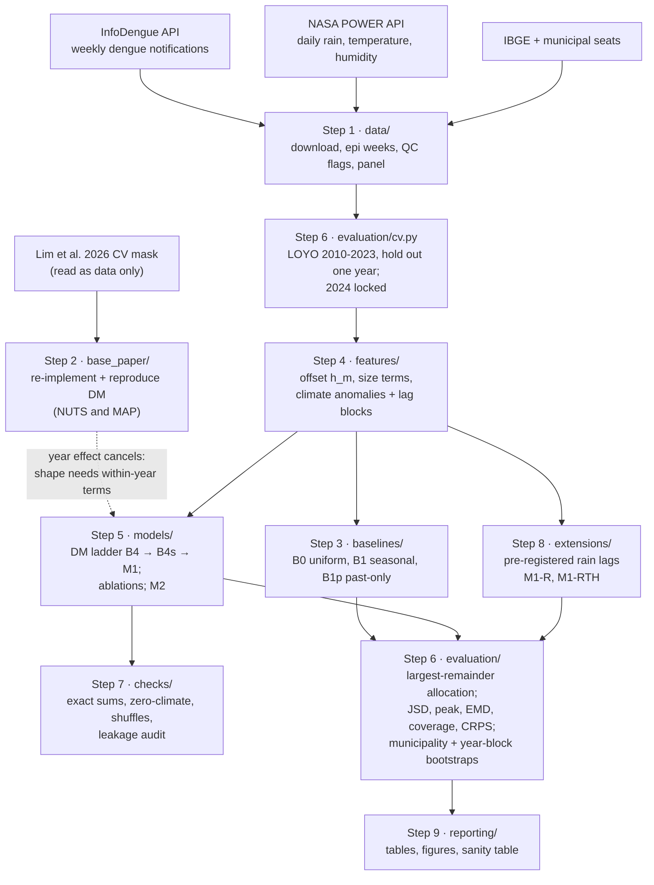

# Climate-informed reconstruction of weekly dengue curves from annual totals

[](pyproject.toml)
[](LICENSE)
[](https://colab.research.google.com/github/aminah9945/dengue-climate-reconstruction/blob/main/notebooks/00_setup_and_data.ipynb)

**Status: official results for 2010–2023 (see [Results](#7-results)). The 2024 test year is locked (`RUN_FINAL_2024 = False`) and will be run once, only after the final model is fixed.**

**New here? Follow [`docs/HOW_TO_RUN.md`](docs/HOW_TO_RUN.md)**: a short step-by-step guide for Google Colab and for a local VS Code / Jupyter setup, how to reproduce each official result and figure, expected runtimes and troubleshooting.

> The notebooks in this repository (`notebooks/00`–`06`) replace the older notebooks that were shared through Google Drive. Use the GitHub versions; the Drive copies are no longer updated.

**Author:** Aminah, FAST-NUCES Islamabad (MS research paper).

This repository reproduces a published Dirichlet-multinomial disaggregation model (Lim et al. 2026) and extends it with lagged climate anomalies. The aim is to reconstruct weekly dengue notification curves of Brazilian municipalities from their known annual totals. Everything runs on an ordinary CPU, locally or in Google Colab.

---

## Contents

1. [Topic and problem statement](#1-topic-and-problem-statement)
2. [Workflow](#2-workflow)
3. [Repository structure](#3-repository-structure)
4. [Setup and running](#4-setup-and-running)
5. [Data](#5-data)
6. [Methodology-to-code mapping](#6-methodology-to-code-mapping)
7. [Results](#7-results)
8. [Deviations from the methodology](#8-deviations-from-the-methodology)
9. [Verification](#9-verification)
10. [Citing the data and this code](#10-citing-the-data-and-this-code)

---

## 1. Topic and problem statement

Many dengue records give reliable **annual totals** but not the **weekly timing** of cases (OpenDengue, and published Pakistani data, which are mostly annual or provincial). The usual fix spreads a known total with an average seasonal curve. But epidemic timing shifts from year to year: in our data, a typical Brazilian municipality's peak week moves by about ±6 weeks between years, and in almost half of all years it falls more than a month from its usual week.

**Problem statement.** Weekly climate data exist for the same years, and climate affects dengue with delays of weeks to months. Within the reviewed literature it has not been tested whether a year's **own lagged climate** improves the reconstruction of its weekly curve **beyond seasonality and the known totals**, by how much, and in which places and years.

**How we test it.** For a held-out year we hide the weekly counts and keep only the annual total, the previous year's total and the weekly climate. A model predicts the 52 or 53 weekly *shares*. The shares are multiplied by the total and rounded with the largest-remainder rule, so the weekly counts add up exactly to it. The result is scored against the hidden truth with the Jensen–Shannon divergence (JSD).

**Research questions**

- **RQ1 / H1.** Does adding lagged climate (model M1) lower the JSD compared with the same Dirichlet-multinomial model without climate but with annual-size information (B4s)?
- **RQ2 / H2.** Do long lags (up to 20 weeks) add information beyond short lags (0–3 weeks)?
- **RQ3 / H3.** Where and when does climate help? (Pre-stated: the South and Southeast gain more than the North.)

**Base paper.** Lim et al. (2026), *Rapid global growth and intensification of dengue since 1990* (Research Square preprint), stage 4 of the OpenDengue gap-filling pipeline: a hierarchical Dirichlet-multinomial (DM) that splits annual totals into months. Its year effect is constant across months, so it cancels in the softmax: the model gives every held-out year of a country the **same** shape. Year-specific shape can only come from terms that vary *within* the year, such as climate.

**Data.** Weekly notified dengue cases (InfoDengue/SINAN) and NASA POWER climate for 300 municipalities in all 27 Brazilian states, 2010–2024. Validation is leave-one-year-out (LOYO) over 2010–2023, and 2024 is kept as an untouched final-test year.

## 2. Workflow



More diagrams (per-fold data flow and the model ladder B0 → B1 → B4 → B4s → M1) are in [`docs/ARCHITECTURE.md`](docs/ARCHITECTURE.md).

## 3. Repository structure

```
dengue-climate-reconstruction/
├── README.md                  this file
├── pyproject.toml             installable package (pip install -e .)
├── requirements.txt           pip requirements
├── environment.yml            conda environment
├── LICENSE                    MIT
├── CITATION.cff
├── src/dengue_recon/          the package: one sub-package per methodology step
│   ├── config.py              paths (env vars), seeds, penalties, RUN_FINAL_2024 = False
│   ├── data/                  Step 1: download.py, build_dataset.py, epiweeks.py, validate_sources.py, eda.py, panel.py, oni.py, validate_weather.py
│   ├── base_paper/            Step 2: lim_dm.py (re-implementation), reproduce.py (runner), fetch.py (CV mask)
│   ├── baselines/             Step 3: simple.py (B0, B1, B1p)
│   ├── features/              Step 4: seasonal.py, size_terms.py, climate.py
│   ├── models/                Step 5: dirichlet_multinomial.py (B4/B4s/M1 + ablations), xgb_softmax.py (M2)
│   ├── evaluation/            Step 6: cv.py, allocation.py, metrics.py, scoring.py, bootstrap.py
│   ├── checks/                Step 7: sums.py, zero_climate.py, shuffle.py, leakage.py, sanity.py
│   ├── extensions/            Step 8: rain_lags.py (M1-R, M1-RTH, pre-registered)
│   ├── reporting/             Step 9: tables.py, figures.py, report.py, rain_report.py, official_report.py
│   └── experiments/           brazil_loyo.py: runs Steps 3-7 in every LOYO fold (pilot);
│                              official.py: designs A/B/C with ONI and M2 early stopping
├── scripts/
│   ├── run_pipeline.py        CLI: --step {data,reproduce,baselines,brazil,m2,extension,report,official,official-report,all}
│   ├── official_postcheck.py  re-checks one finished official run and writes its summary tables
│   └── build_notebooks.py     regenerates notebooks 00-05 (06 is edited by hand)
├── notebooks/                 00-06, Colab-ready (setup cell clones and installs this repo); 06 = official experiments
├── tests/                     pytest, synthetic data only, about 7 s
├── data/README.md             sources, URLs, licences, schema, QC flags (no data files committed)
├── results/                   small CSV/JSON/PNG outputs of the pilot (see results/README.md)
└── docs/                      METHODOLOGY_MAPPING, DEVIATIONS, ARCHITECTURE, RESULTS, VERIFICATION, WEATHER_VALIDATION
```

## 4. Setup and running

### 4.1 Google Colab

Open a notebook with the direct links in [`docs/HOW_TO_RUN.md`](docs/HOW_TO_RUN.md#1-google-colab) or the Colab badge above (or *File → Open notebook → GitHub* and paste this repository's URL). The first cell of every notebook:

1. runs `git clone --branch BRANCH https://github.com/aminah9945/dengue-climate-reconstruction` into `/content/` (`BRANCH = "main"` by default; set it to `"official-run"` to use the official-run branch before its pull request is merged);
2. runs `pip install -e ".[all]"`;
3. sets `DATA_DIR` and `RESULTS_DIR` (set `USE_DRIVE = True` to keep the downloaded data on Google Drive).

Then run the notebooks in order:

| Notebook | What it does | Time (CPU) |
|---|---|---|
| `00_setup_and_data.ipynb` | Downloads and builds the data (Step 1), fetches the base-paper CV mask, shows the EDA | 30–45 min the first time |
| `01_reproduce_base_paper.ipynb` | Reproduction of Lim et al. (Step 2): MAP live, NUTS precomputed (`RUN_NUTS = True` to refit) | about 1 min |
| `02_brazil_baselines.ipynb` | B0, B1, B1p, B4, B4s; live single-fold demo | seconds (refit: about 5 min) |
| `03_climate_extension.ipynb` | M1, ablations, sanity checks, region and year results (`QUICK = True` refits B4/B4s/M1 in about 5 min) | seconds |
| `04_results_figures.ipynb` | All result tables and figures | seconds |
| `05_rain_lag_extension.ipynb` | Pre-registered rain-lag extension (Step 8) | seconds (refit: about 6 min) |
| `06_official_experiments.ipynb` | Official results (designs A/B/C) and an optional re-run of one design | seconds (re-run: see [`docs/HOW_TO_RUN.md`](docs/HOW_TO_RUN.md#4-expected-runtimes)) |

A GPU is not needed. Only the optional NUTS refit benefits from one (`pip install "jax[cuda12]"`).

### 4.2 Local (Linux, macOS, Windows/WSL)

```bash
git clone https://github.com/aminah9945/dengue-climate-reconstruction
cd dengue-climate-reconstruction

# either pip ...
python -m venv .venv && source .venv/bin/activate        # Windows: .venv\Scripts\activate
pip install -e ".[all]"                                   # same as: pip install -r requirements.txt && pip install -e .
# ... or conda
conda env create -f environment.yml && conda activate dengue-recon

python -m pytest                                          # 48 tests, about 10 s, no data needed
```

Run the pipeline step by step (each step maps to Section 6):

```bash
python scripts/run_pipeline.py --step data                        # Step 1: download + build + ONI (30-45 min); --with-chirps adds CHIRPS (1-2 h)
python scripts/run_pipeline.py --step reproduce                   # Step 2: MAP (about 1 min); add --nuts for NUTS
python scripts/run_pipeline.py --step brazil --subset 60 --quick  # Steps 3-7: B0..M1 weekly, 60 municipalities (about 5 min)
python scripts/run_pipeline.py --step brazil --subset 60          # full pilot incl. ablations and shuffles (about 22 min)
python scripts/run_pipeline.py --step brazil --res monthly --subset 60   # monthly analogue (about 18 min)
python scripts/run_pipeline.py --step brazil --subset 300         # 300 municipalities, main models (about 41 min)
python scripts/run_pipeline.py --step m2                          # optional boosted softmax (needs the weekly 60 run)
python scripts/run_pipeline.py --step extension --subset 60       # Step 8 (about 8 min); --subset 300 about 29 min
python scripts/run_pipeline.py --step report                      # Step 9: tables and figures
python scripts/run_pipeline.py --step all                         # everything above, in order (not 'official')
```

**Official experiment (designs A/B/C).** Each fold is checkpointed under `results/official/<tag>/folds/`. Rerunning the same command resumes from the last finished fold and gives identical numbers. `2024` is never loaded while `RUN_FINAL_2024 = False`.

```bash
python scripts/run_pipeline.py --step official --design A --climate power --subset 300    # primary: expanding window, 12 folds
python scripts/run_pipeline.py --step official --design B --climate power --subset 300    # learning curve, 30 folds
python scripts/run_pipeline.py --step official --design C --climate power --subset 300    # LOYO, 14 folds (pilot comparison)
python scripts/run_pipeline.py --step official --design A --climate chirps --subset 300   # robustness: CHIRPS rainfall
python scripts/run_pipeline.py --step official --design A --climate power --subset 300 --exclude-year 2020   # without 2020
python scripts/run_pipeline.py --step official-report     # statistics, tables, figures -> results/official/{tables,figures}
python scripts/official_postcheck.py results/official/designA_power_300   # re-check one finished run
# options: --models B1,B4s,M1 (subset of models), --years 2016,2019 (subset of test years), --out DIR
```

The official runs need `oni_weekly.parquet` (made by `--step data`, or `python -m dengue_recon.data.oni`), and the CHIRPS run needs `climate_weekly_chirps.parquet` (`--step data --with-chirps`). `official-report` reads the per-row `metrics_detail_<tag>.csv` files, which are written by the runs but not committed (5–7 MB each), so on a fresh clone run the five official commands first; the committed tables and figures in `results/official/` can be read without rerunning anything.

Outputs per run (`<tag>` = e.g. `designA_power_300`):

| File | Content |
|---|---|
| `metrics_detail_<tag>.csv` | per municipality-year and model: the pilot's metric columns plus `design`, `fold_id`, `k`, `climate` |
| `fold_log_<tag>.csv` | per fold and model: runtime, L-BFGS iterations and gradient, M2's chosen settings and rounds |
| `leakage_audit_<tag>.csv` | per-fold leakage audit |
| `checks_<tag>.json` | summary of the per-fold checks |
| `run_info.json` | the run's settings |
| `folds/` | checkpoints: predictions `.npz`, fold logs, per-fold metrics (not committed) |

Times are measured on 4 CPUs with 15 GB RAM; memory stays below 3 GB.

**Environment variables** (all optional; see `src/dengue_recon/config.py`):

| Variable | Default | Meaning |
|---|---|---|
| `DATA_DIR` | `<repo>/data` | processed data and `raw/` downloads |
| `RESULTS_DIR` | `<repo>/results` | outputs |
| `REPORTS_DIR` | `<RESULTS_DIR>/data_foundation` | EDA and smoke-test outputs |
| `LIM_MASK_PATH` | `<DATA_DIR>/raw/lim_repo/masks/inla_down_mask_interp_gzip_v2.rds` | base-paper CV mask |
| `DENGUE_ROOT` | repository root | used when the package is installed elsewhere |

**Reproducibility.** Fixed seeds throughout (`config.SEED = 20250811`, bootstrap seed 1, NUTS seed `20250811 + 10000 + 100·fold`), float64 JAX, pilot hyperparameters frozen in `config.py`. `RUN_FINAL_2024 = False`: 2024 is never loaded.

## 5. Data

No data files are committed. Step 1 downloads everything from the original public sources into `DATA_DIR`. Full details (URLs, licences, processing, the schema of every processed file, QC flags) are in **[`data/README.md`](data/README.md)**.

| Source | Content | Link |
|---|---|---|
| InfoDengue (SINAN) | Weekly notified dengue cases per municipality, 2010–2025 | https://info.dengue.mat.br/api/alertcity |
| NASA POWER | Daily precipitation, temperature (mean, min, max), relative humidity at the municipal seat, 2009–2025 | https://power.larc.nasa.gov/ |
| IBGE SIDRA 6579 | 2021 population (candidate pool) | https://apisidra.ibge.gov.br/ |
| kelvins/municipios-brasileiros | Coordinates of municipal seats (MIT) | https://github.com/kelvins/municipios-brasileiros |
| Cox et al. 2024 (optional) | ERA5-Land rainfall and SINAN totals, 2013–2020, for validation (CC BY 4.0) | https://doi.org/10.5281/zenodo.13286671 |
| Lim et al. 2026 repository | CV mask and published table, for the reproduction only (code never executed) | https://github.com/ahyoung-lim/OD_gap_filling_public (commit `00ff7ae`) |

Processed panel: 300 municipalities × 835 epi weeks (250,500 rows), no missing case weeks, NASA POWER complete for 2009–2024. Quality flags: Espírito Santo 2021 excluded (reporting artefact); 2020 kept but all results also reported without it; 2025 provisional and excluded; 53-week years (2014, 2020) handled with a 53-slot grid.

## 6. Methodology-to-code mapping

Each step of the methodology maps to one sub-package; the full table with every function and the tests is in **[`docs/METHODOLOGY_MAPPING.md`](docs/METHODOLOGY_MAPPING.md)**.

| Step | Methodology (final proposal §) | File | Main functions |
|---|---|---|---|
| 1 | Data acquisition and municipality selection (§7.1) | `src/dengue_recon/data/download.py` | `download_meta`, `download_infodengue`, `select_municipalities`, `download_power` |
| 1 | Epi weeks, 53-week years (§7.2) | `src/dengue_recon/data/epiweeks.py` | `calendar`, `weeks_in_epiyear`, `date_to_epiweek` |
| 1 | Tidy tables and QC flags (§7.1) | `src/dengue_recon/data/build_dataset.py` | `load_infodengue`, `load_power`, `main` |
| 1 | Source validation; EDA and smoke test (§8.1–8.3) | `src/dengue_recon/data/validate_sources.py`, `data/eda.py` | `main` |
| 1 | Model panel, 53-slot grid, monthly variant, pilot subset (§7.2) | `src/dengue_recon/data/panel.py` | `load_tables`, `select_subset60`, `build_panel`, `climate_matrix` |
| 2 | Reproduction of Lim et al. 2026 DM (§3.2, §8.4) | `src/dengue_recon/base_paper/lim_dm.py` | `build_arrays`, `numpyro_model`, `fit_nuts`, `fit_map`, `score_incidence`, `cancellation`, `run_fold` |
| 2 | Reproduction runner, published comparison | `src/dengue_recon/base_paper/reproduce.py`, `fetch.py` | `run`, `table`, `fetch_lim_mask` |
| 3 | Baselines B0, B1, B1p (§7.4) | `src/dengue_recon/baselines/simple.py` | `uniform_shares`, `seasonal_shares`, `past_only_shares` |
| 4 | Seasonal offset h_m (§7.2) | `src/dengue_recon/features/seasonal.py` | `offsets`, `seasonal_profile`, `adapt_length` |
| 4 | Annual-size terms for B4s (§7.4) | `src/dengue_recon/features/size_terms.py` | `size_covariates`, `harmonics` |
| 4 | Climate anomalies and lag blocks (§7.2, Eq. 3) | `src/dengue_recon/features/climate.py` | `climate_anomalies`, `lag_block_features`, `climate_features` |
| 5 | DM ladder B4 → B4s → M1, penalised likelihood, L-BFGS + JAX (§7.4, Eq. 2) | `src/dengue_recon/models/dirichlet_multinomial.py` | `DMModel.fit`, `DMModel.predict`, `variant_inputs` |
| 5 | Uncertainty: Dirichlet → multinomial draws (§7.5) | `src/dengue_recon/models/dirichlet_multinomial.py` | `draw_counts` |
| 5 | M2 boosted softmax (optional, §7.4) | `src/dengue_recon/models/xgb_softmax.py` | `group_softmax`, `design`, `main` |
| 6 | LOYO folds, exclusions, 2024 lock (§7.6) | `src/dengue_recon/evaluation/cv.py` | `row_masks`, `loyo_folds`, `final_test_split` |
| 6 | Official designs: **A** expanding window (primary), **B** learning curve, **C** LOYO | `src/dengue_recon/evaluation/cv.py` | `expanding_window_folds`, `learning_curve_folds`, `loyo_fold_specs`, `climate_years`, `panel_years` |
| 4 | ONI (ENSO) lag-block features (5, national), standardised with training years; climate source switch POWER/CHIRPS | `src/dengue_recon/features/climate.py`, `data/panel.py` | `oni_block_features`, `fold_climate_features`, `load_oni_weekly`, `load_tables(climate=...)` |
| 5 | Official M2: fixed grid, early stopping on the last training year | `src/dengue_recon/models/xgb_softmax.py` | `fit_predict_official` |
| 3–7 | Official driver with per-fold checkpoints and checks | `src/dengue_recon/experiments/official.py`, `checks/leakage.py` | `main`, `run_fold`, `official_leakage_audit` |
| 6 | Exact-total allocation (§2, §7.3) | `src/dengue_recon/evaluation/allocation.py` | `allocate_integers` |
| 6 | Metrics (§7.7) | `src/dengue_recon/evaluation/metrics.py`, `scoring.py` | `jsd`, `peak_week_error`, `emd_weeks`, `crps_samples`, `jsd_floor`, `score` |
| 6 | Bootstraps and paired comparisons (§7.9) | `src/dengue_recon/evaluation/bootstrap.py` | `cluster_bootstrap`, `paired`, `h3_contrast` |
| 3–7 | Per-fold driver | `src/dengue_recon/experiments/brazil_loyo.py` | `main` |
| 7 | Sanity checks 1–7 (§7.8) | `src/dengue_recon/checks/` | `allocation_sum_ok`, `zero_climate_maxdiff`, `shuffle_years`, `shuffle_test_year`, `leakage_audit`, `sanity_table` |
| 8 | Pre-registered rain-lag extension | `src/dengue_recon/extensions/rain_lags.py` | `feature_spec`, `ext_climate_features`, `ext_leakage_audit`, `main` |
| 9 | Where/when analysis, tables, figures (§7.10) | `src/dengue_recon/reporting/` | `region_table`, `gain_by_year`, `paired_table`, `fig_*`, `report.main` |
| 9 | Official report: paired contrasts with both bootstraps, H1–H3 with Holm, H4 learning-curve slopes, region / epidemic / weather-source tables, coefficients, figures | `src/dengue_recon/reporting/official_report.py` | `contrast`, `hypothesis_table`, `group_contrast`, `learning_curve_tables`, `lc_slope`, `epidemic_labels`, `coefficient_table`, `main` |

## 7. Results

### 7.1 Official results (2010–2023; 2024 locked)

These results come from the official experiment, run as pre-registered: 300 municipalities, NASA POWER climate (Amendment 1), test years **2010–2023** only. **2024 is locked** (`RUN_FINAL_2024 = False`): it has never been loaded and will be used once, as the final test, only after the final model is fixed. Full write-up: **[`results/official/OFFICIAL_RESULTS.md`](results/official/OFFICIAL_RESULTS.md)**. Tables: [`results/official/tables/`](results/official/tables/). Figures: [`results/official/figures/`](results/official/figures/). Regenerate with `python scripts/run_pipeline.py --step official-report`.

| Hypothesis (design A, primary) | Estimate | 95 % CI, municipalities | 95 % CI, years | Decision |
|---|---|---|---|---|
| H1: M1 − B4s (JSD), needs ≤ −5 % | +0.00012 (+0.1 %) | [−0.00090, +0.00120] | [−0.00370, +0.00396] | **Not supported** |
| H2: M1 − M1-short | +0.00247 (+2.1 %) | [+0.00185, +0.00309] | [−0.00172, +0.00675] | **Not supported** |
| H3: gain South+Southeast − North | +0.00467 | [+0.00209, +0.00746] | [−0.00420, +0.01318] | **Not supported** |

Holm correction does not change any decision.

- **Climate adds no accuracy in the primary design.** M1 (local weather + ONI) equals B4s and wins in 5 of 12 test years.
- **Local weather alone gives a small gain; ONI removes it.** M1-noONI − B4s is −1.3 %: the municipality interval excludes 0, the year-block interval does not.
- **Annual-size terms matter most.** B4s vs B4 lowers JSD by 5.3 % (17.0 % N-weighted).
- **Learning curve (H4).** From 3 to 9 training years every model improves. M1 improves fastest and is 1–3 % below B4s from 5 years on (year-block intervals include 0). k = 2 uses regional profiles, and k ≥ 10 has fewer test years, so both are shown separately.
- **Robustness.** CHIRPS rainfall and dropping 2020 give the same conclusions. Design C reproduces the pilot exactly.

Key figures: [`figA_designA_jsd_by_test_year.png`](results/official/figures/figA_designA_jsd_by_test_year.png), [`figB_learning_curves.png`](results/official/figures/figB_learning_curves.png), [`figC_gain_with_CIs.png`](results/official/figures/figC_gain_with_CIs.png), [`figD_gain_by_region.png`](results/official/figures/figD_gain_by_region.png).

### 7.2 Pilot results (superseded by 7.1 for the hypotheses)

All numbers are from [`docs/RESULTS.md`](docs/RESULTS.md) and [`results/rain_extension/RESULTS_RAIN.md`](results/rain_extension/RESULTS_RAIN.md). They are **preliminary**: 60 municipalities (12 per region), LOYO 2010–2023 with pilot hyperparameters fixed in advance, plus a 300-municipality run with the same frozen settings. 2024 was never loaded, so **no gain here is confirmed**.

**Step 2: the base paper is reproduced.**

| | MAE* | RMSE* | 80 % coverage | CRPS |
|---|---|---|---|---|
| Published DM (3 reps, 4 × 1,000 draws) | 13.4 | 78.5 | 0.95 | 9.6 |
| Ours, NUTS (rep01, 2 × 500 draws) | **13.34** | **78.1** | **0.948** | **9.53** |
| Ours, MAP | 12.18 | 68.3 | 0.958 | 8.66 |

\* incidence per 100,000, posterior-predictive median (the published definition). MAE is within 0.5 % (criterion ±10 %) and coverage within 0.002 (criterion ±0.03). Cancellation confirmed: predicted shapes of different held-out years of the same country are identical to 1.1e-16.

**Steps 3–6: weekly reconstruction, mean JSD per municipality-year** (lower is better; 95 % municipality-bootstrap intervals)

| Model | JSD, 60 municipalities | JSD, 300 municipalities | Peak-week error (60), weeks |
|---|---|---|---|
| B0 uniform | 0.137 [0.126, 0.148] | 0.189 [0.182, 0.195] | 11.7 |
| B1p seasonal, past years only | 0.094 [0.085, 0.104] | 0.136 [0.130, 0.142] | 6.20 |
| B1 seasonal profile (LOYO) | 0.082 [0.074, 0.091] | 0.120 [0.115, 0.125] | 5.97 |
| B4 DM, base-paper structure | 0.082 [0.074, 0.090] | 0.119 [0.114, 0.124] | 5.80 |
| **B4s** DM + annual size (primary comparator) | **0.0735** [0.066, 0.082] | **0.111** [0.106, 0.116] | 5.97 |
| **M1** B4s + climate | **0.0727** [0.065, 0.081] | **0.108** [0.103, 0.113] | 5.92 |
| M2 boosted softmax (60 only) | 0.0769 [0.069, 0.085] | – | 6.08 |

**Primary contrast M1 − B4s (H1)**

| | Mean difference | Relative | 95 % CI, municipalities | 95 % CI, years | Years better |
|---|---|---|---|---|---|
| Weekly, 60 municipalities | −0.00084 | −1.1 % | [−0.00197, +0.00022] | [−0.00426, +0.00267] | 9/14 |
| Weekly, 300 municipalities | −0.00335 | −3.0 % | [−0.00404, −0.00267] | [−0.00660, +0.00011] | 10/14 |

**What this means (pilot readings, not hypothesis tests)**

- **H1, climate gain: small.** Not supported in the 60-municipality pilot (both intervals include 0). At 300 municipalities the gain is −3.0 %: the municipality interval excludes 0, the year-block interval just includes it, and the gain is below the proposed 5 % practical threshold. At monthly resolution climate adds nothing beyond B4s (JSD 0.061 for both).
- **The signal is real but small.** Shuffling climate between years (refitted, 3 seeds) removes the gain (shuffled − B4s = +0.00044 [+0.00022, +0.00068]). Giving the trained M1 another year's climate makes it worse (JSD 0.0761 vs 0.0727 at 60; 0.1133 vs 0.1077 at 300).
- **H2, long lags: partly supported.** M1 vs M1-short (lags 0–3 only): −1.4 % (municipality CI below 0; year CI includes 0). The fitted signal sits in rainfall 4–7 weeks and temperature 12–20 weeks before.
- **H3, where: consistent with the hypothesis.** Gain in (South + Southeast) − North: +0.0041 [0.0018, 0.0064] at 60 and +0.0080 [0.0068, 0.0092] at 300 (municipality bootstrap). Climate slightly hurts in the North and Northeast, where NASA POWER rainfall is least reliable.
- **Strongest non-climate finding.** Annual-size terms (B4s vs B4) cut JSD by 10.0 % (60) and 6.8 % (300), in 12–14 of 14 years. B4 without year-varying terms is essentially the seasonal profile B1, which matches the cancellation result.
- **Calibration.** 80 % coverage of weekly counts: B4s 0.80 / 0.81, M1 0.78 / 0.80 (60 / 300); plug-in parameters slightly under-cover.
- **Step 7, sanity checks: all pass.** Exact sums for every allocation and draw; uniform is worst; zero-climate equivalence (max difference 0.0); both shuffle checks; leakage audit in every fold; pipeline consistency with the smoke test (max |ΔJSD| 1.1e-16); final-test path unit-tested; 2024 untouched.
- **Step 8, rain-lag extension (pre-registered): no improvement.** M1-R (dual rain lags to 26 weeks) vs M1: +1.7 % (60) and +0.6 % (300) JSD; M1-RTH: +4.5 % and +1.9 %. M1 remains the best climate model.

Key figures: [`results/figures/fig_baseline_vs_climate_weekly_300.png`](results/figures/fig_baseline_vs_climate_weekly_300.png), [`fig_gain_by_region_year_weekly_300.png`](results/figures/fig_gain_by_region_year_weekly_300.png), [`fig_example_bh.png`](results/figures/fig_example_bh.png), [`fig_repro_lim.png`](results/figures/fig_repro_lim.png).

**Rule for use:** reconstructed weekly series must **not** be used to estimate climate–dengue effects or to train climate-based dengue models, because that would be circular.

## 8. Deviations from the methodology

Every deviation is explained and justified in **[`docs/DEVIATIONS.md`](docs/DEVIATIONS.md)**. In short:

- **Climate source:** NASA POWER (keyless API, complete daily series) is the only climate input; ERA5-Land (needs an account and large gridded downloads) was used only for validation. Monthly rainfall anomalies agree with ERA5-Land at r = 0.71 overall but 0.47 in the North. The planned ERA5-Land re-run of the North is not done yet.
- **Fitting:** Brazil models use penalised likelihood (MAP; L-BFGS with JAX gradients) instead of full Bayesian NUTS, because of CPU time; NUTS is used for the reproduction. Penalty scales are fixed, not estimated.
- **Reduced reproduction:** 1 repetition, 2 chains × (500 + 500) draws, target_accept 0.95 (paper: 3 repetitions, 4 × 1,000, 0.99). The criteria were still met.
- **Base model choice:** the base paper's final disaggregation model is scaled INLA (MAE 10.7, 80 % coverage 0.87). We extend its Dirichlet-multinomial (MAE 13.4–13.5, coverage 0.95): open Python code, calibrated intervals, and climate enters the logits directly for a clean nested test.
- **Not run (yet):** Denton/Chow–Lin baselines; ENSO (ONI) features in the pilot (added in the official experiment, see below); the monthly-to-weekly spline of Morello et al.; some ablations and stratifications; the **2024 final test** (`RUN_FINAL_2024 = False` by design).
- **Scaled down:** M2 without early stopping (fixed 300 rounds) and weekly pilot only; the 300-municipality run without the train-and-test shuffle; H3 with the municipality bootstrap only; small convergence and specification details (listed in the file).
- **Official experiment (Amendment 1, fixed before any official model run):** ERA5-Land could not be obtained (Open-Meteo daily quota; Copernicus needs an account), so NASA POWER is the primary climate and CHIRPS rainfall is the robustness source; ONI lag blocks are added to M1 (20 features; the pilot M1 is kept as M1-noONI); M2 uses early stopping on the last training year. Fold rules: [`docs/DEVIATIONS.md`](docs/DEVIATIONS.md#g-official-experiment-designs-abc-amendment-1).
- **Repository refactor:** the research code was split into the package without changing numerical behaviour (verified exactly).

## 9. Verification

[`docs/VERIFICATION.md`](docs/VERIFICATION.md) records the checks of the refactored code on the original processed data:

- `pytest`: 48 tests pass in about 10 s, without downloaded data (20 at the pilot refactor, 37 before the official report).
- Weekly 60-municipality run (B0, B1, B1p, B4, B4s, M1): predictions **identical** to the saved pilot (max |Δshare| = 0). Mean JSD B1 0.082017, B4s 0.073505, M1 0.072669.
- MAP reproduction identical to 4+ decimals (pooled median MAE 12.1775, coverage 0.9581, CRPS 8.6626).
- Rain extension M1-R (60): JSD 0.073892, identical.
- Report tables regenerate identically, and all notebooks (00–06) execute without errors.

## 10. Citing the data and this code

Please cite the data sources (full references and acknowledgement texts in [`data/README.md`](data/README.md)):

- InfoDengue: Codeço C. et al. (2018), *Infodengue: A nowcasting system for the surveillance of arboviruses in Brazil*, Rev. Epidemiol. Santé Publique 66:S386, https://doi.org/10.1016/j.respe.2018.05.408 ; underlying data: SINAN, Ministério da Saúde.
- NASA POWER: "These data were obtained from the NASA Langley Research Center (LaRC) POWER Project funded through the NASA Earth Science/Applied Science Program." https://power.larc.nasa.gov/
- IBGE (SIDRA table 6579) and kelvins/municipios-brasileiros (MIT).
- Cox V. M. (2024), Zenodo, https://doi.org/10.5281/zenodo.13286671 (CC BY 4.0), if the validation step is used.
- Base paper: Lim A., Joshi K., …, Brady O. J. (2026), *Rapid global growth and intensification of dengue since 1990*, Research Square, https://doi.org/10.21203/rs.3.rs-8976788/v1 ; code: https://github.com/ahyoung-lim/OD_gap_filling_public (cited, not redistributed).

To cite this repository, use [`CITATION.cff`](CITATION.cff) (GitHub shows a "Cite this repository" button).

## License

Code: MIT, see [`LICENSE`](LICENSE). Data are not included; each source keeps its own terms (see `data/README.md`).
