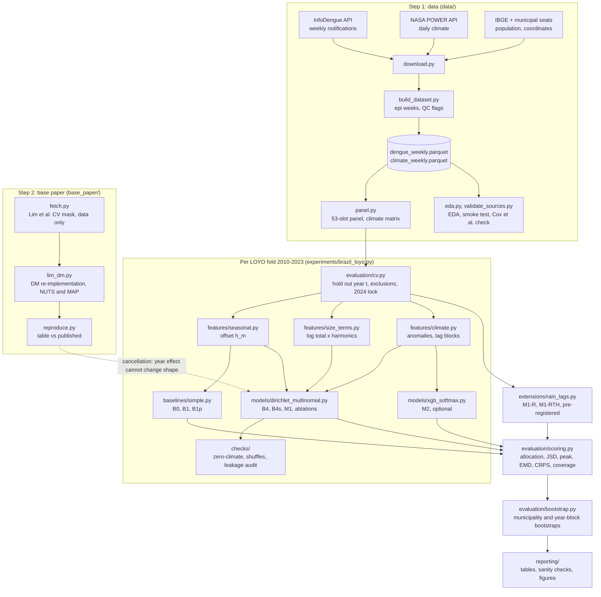
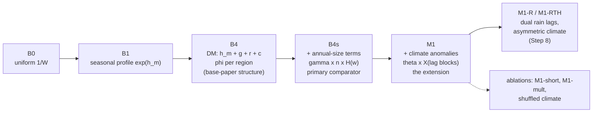

# Architecture

## Pipeline

Every box names the module that implements it. Steps 3–7 run once per leave-one-year-out (LOYO) fold inside `experiments/brazil_loyo.py`.



## Model ladder

Each rung adds one block of terms to the logits of the same Dirichlet-multinomial model, so every comparison is nested. The primary contrast for the research question is **M1 vs B4s**.



Logit of municipality m, year t, week s (Eq. 2 of the proposal):

```
logit[m,t,s] = h[m,s] + g[s] + r[R(m),s] + c[m,s]                       (B4)
             + sum_k (gamma[k] + gamma_reg[R(m),k]) * Z[m,t,s,k]          (+ B4s)
             + sum_f (theta[f] + delta[R(m),f]) * X[m,t,s,f]              (+ M1)
pi[m,t,:]    = softmax over the real weeks of year t
y[m,t,:]     ~ DirichletMultinomial(N[m,t], phi[R(m)] * pi[m,t,:])
```

The base paper's year-constant effect is left out. It is the same for every week, so it cancels in the softmax (`tests/test_models.py::test_year_effect_cancels_in_softmax`; maximum share difference 1.1e-16 in the reproduction).

## Data flow and file layout

```
DATA_DIR (default data/, git-ignored)
  raw/infodengue/<geocode>.csv, raw/power/<geocode>.csv, raw/meta/, raw/lim_repo/
  dengue_weekly.parquet, climate_weekly.parquet, municipalities.csv, year_summary.csv
RESULTS_DIR (default results/)
  data_foundation/   EDA, smoke test, source validation           (Step 1)
  repro_lim/         reproduction table, folds, cancellation        (Step 2)
  brazil/            preds_*.npz*, metrics_detail_*, tables, checks (Steps 3-7, 9)
  rain_extension/    pre-registration, tables, figures             (Steps 8, 9)
  figures/           main figures                                   (Step 9)
* large files are not committed; see results/README.md
```

## Design rules enforced in code

- **No leakage.** Every statistic estimated from data (offsets, climatology, SDs, centring constants) is computed from training rows of the fold only; `checks/leakage.py` recomputes each with the held-out year blanked and requires identical values, in every fold.
- **Exact totals.** Allocation and every probabilistic draw are asserted to sum to the annual total.
- **2024 untouched.** `config.RUN_FINAL_2024 = False`; `data.panel.load_tables` drops 2024 and later; `evaluation.cv.assert_final_year_locked` guards the drivers.
- **Determinism.** Fixed seeds (`config.SEED`, bootstrap seed 1, NUTS seed `20250811 + 10000 + 100·fold`) and float64 JAX. The refactored code reproduces the saved pilot predictions exactly (`docs/VERIFICATION.md`).
- **Base-paper code is never executed.** Its repository is cloned at a pinned commit only to read the CV mask and the published table.
