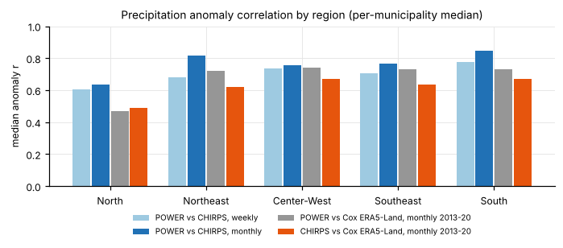
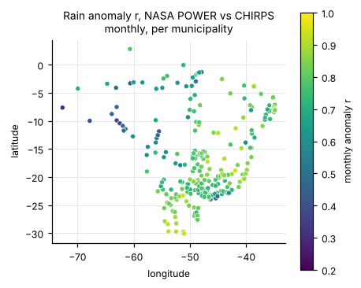
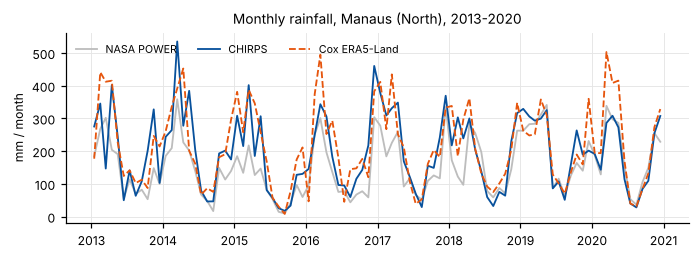

# Weather source validation

This note compares the NASA POWER weather used by the pilot with an alternative daily source for the same 300 municipal seats, and with the Cox et al. ERA5-Land extract. No dengue model was run for it. Date: 2026-10-27.

## What was downloaded

| Source | Status | Coverage |
|---|---|---|
| ERA5-Land via Open-Meteo (`models=era5_land`), the intended source | **Not obtained.** Every request returned HTTP 429 *"Daily API request limit exceeded"*. Open-Meteo also counts 17 years for one point as about 440 calls, so 300 points need about 130,000 calls against a free limit of 10,000 per day | – |
| ERA5 via Open-Meteo (`models=era5`), first fallback | **Not obtained.** Same daily-limit refusal (2 isolated probes succeeded, then the limit applied) | – |
| **CHIRPS v2.0** daily rainfall (0.05°) via SERVIR ClimateSERV, second fallback | **Downloaded** (one extraction job per municipality, about 70 s each) | 300 municipalities × 6,209 days (2009-01-01 – 2025-12-31), **0 missing days** |
| NOAA CPC ONI | Downloaded | 1950 – 2026 (monthly); 887 epi weeks 2009 W1 – 2025 W53, 0 missing |

The code for the Open-Meteo path (`download.py weather --source era5land`, `build_dataset.py --source era5land`, `validate_weather.py --source era5land`) is in place and resumable (one cached JSON per municipality). It was checked against the quota refusal, but no ERA5-Land data could be validated through it. ERA5-Land still enters the comparison through the Cox et al. (2024) extract (population-weighted municipal means, weekly, 2013–2020).

Processed outputs (in `DATA_DIR`, new files only): `climate_weekly_chirps.parquet` (265,800 rows, same columns, types and epi-week rules as `climate_weekly.parquet`; rainfall from CHIRPS, temperature and humidity copied from NASA POWER), `oni_monthly.csv`, `oni_weekly.parquet`. Sources, URLs and licences: [`data/README.md`](../data/README.md#alternative-weather-sources-and-enso-index-optional-new-files-only).

Check of the refactor: `build_climate("power")` rebuilds `climate_weekly.parquet` exactly from the raw POWER files (`assert_frame_equal`, 265,800 rows), so NASA POWER processing is unchanged.

## Method

`python -m dengue_recon.data.validate_weather --source chirps` (period 2009–2024, 2025 excluded as provisional).

* **Weekly**: epi-week values from the two climate tables (rain = weekly total). **Monthly**: calendar months from the raw daily series (rain summed over complete months). **Cox** (2013–2020): weekly `Rf_cum` (m → mm), `Tmean` and `RH_mean` binned by Cox's `MONTH` label. Cox weeks are ISO-style, so edge weeks blur month boundaries.
* **Anomaly** = value minus the municipality's week-of-year (weekly; week 53 uses week 52) or month-of-year (monthly) mean over the compared period. Anomalies measure the year-to-year timing information that the dengue models use.
* For each municipality, the Pearson r is computed; tables give the median (IQR in `summary.csv`) over municipalities.
* **Triple collocation** (monthly rain anomalies, 2013–2020, POWER/CHIRPS/Cox): each source's estimated correlation with the unknown true anomaly. It assumes independent errors. The sources share some inputs (POWER's corrected precipitation and CHIRPS both use satellite-gauge information), so treat it as indicative only.

## Results

**Median per-municipality correlation, anomalies**

| Comparison | Variable, resolution | All | **North** | Northeast | Center-West | Southeast | South |
|---|---|---:|---:|---:|---:|---:|---:|
| POWER vs CHIRPS | rain, weekly | 0.71 | **0.61** | 0.68 | 0.73 | 0.71 | 0.78 |
| POWER vs CHIRPS | rain, monthly | 0.77 | **0.63** | 0.82 | 0.75 | 0.77 | 0.85 |
| POWER vs Cox ERA5-Land | rain, monthly 2013–20 | 0.71 | **0.47** | 0.72 | 0.74 | 0.73 | 0.73 |
| CHIRPS vs Cox ERA5-Land | rain, monthly 2013–20 | 0.63 | **0.49** | 0.62 | 0.67 | 0.63 | 0.67 |
| POWER vs Cox ERA5-Land | mean temperature, monthly 2013–20 | 0.86 | **0.72** | 0.83 | 0.82 | 0.88 | 0.90 |
| POWER vs Cox ERA5-Land | rel. humidity, monthly 2013–20 | 0.80 | **0.64** | 0.82 | 0.81 | 0.81 | 0.77 |

**Median per-municipality correlation, raw values**

| Comparison | Variable, resolution | All | **North** | Northeast | Center-West | Southeast | South |
|---|---|---:|---:|---:|---:|---:|---:|
| POWER vs CHIRPS | rain, weekly | 0.79 | **0.79** | 0.75 | 0.83 | 0.80 | 0.79 |
| POWER vs CHIRPS | rain, monthly | 0.90 | **0.90** | 0.91 | 0.93 | 0.90 | 0.88 |
| POWER vs Cox ERA5-Land | rain, monthly 2013–20 | 0.86 | **0.87** | 0.83 | 0.92 | 0.87 | 0.78 |
| CHIRPS vs Cox ERA5-Land | rain, monthly 2013–20 | 0.82 | **0.87** | 0.78 | 0.89 | 0.82 | 0.71 |
| POWER vs Cox ERA5-Land | mean temperature, monthly 2013–20 | 0.96 | **0.86** | 0.97 | 0.95 | 0.97 | 0.99 |
| POWER vs Cox ERA5-Land | rel. humidity, monthly 2013–20 | 0.86 | **0.87** | 0.91 | 0.94 | 0.86 | 0.77 |

**Mean rainfall:** CHIRPS is wetter than POWER by 16 % overall (North 19 %, Center-West 21 %, South 8 %). Coastal seats differ most, where POWER's 0.5° × 0.625° cell mixes land and sea: Santos, Guarujá and Praia Grande get about 2,400–2,600 mm/yr from CHIRPS vs 1,266 mm from POWER. Some semi-arid seats show the opposite (Jequié 530 vs 1,090 mm, Caruaru 530 vs 850 mm).

**Triple collocation, monthly rain anomalies 2013–2020** (median estimated correlation with the true anomaly):

| Region | n | NASA POWER | CHIRPS | Cox ERA5-Land |
|---|---:|---:|---:|---:|
| All | 300 | 0.91 | 0.81 | 0.77 |
| **North** | 45 | **0.82** | **0.78** | **0.62** |
| Northeast | 45 | 0.92 | 0.81 | 0.79 |
| Center-West | 45 | 0.91 | 0.83 | 0.82 |
| Southeast | 120 | 0.92 | 0.80 | 0.79 |
| South | 45 | 0.98 | 0.88 | 0.75 |

### The North

* The North has the weakest agreement in every comparison: rain anomaly r is 0.61 weekly and 0.63 monthly for POWER vs CHIRPS, 0.47 for POWER vs ERA5-Land and 0.49 for CHIRPS vs ERA5-Land, against 0.7–0.85 elsewhere. Raw-value correlations are high (0.79–0.90), because they are carried by the strong shared seasonal cycle.
* The worst municipalities are in Acre, Rondônia and western Amazonas (POWER vs CHIRPS monthly anomaly r: Cruzeiro do Sul 0.31, Jaru 0.35, Ariquemes 0.37, Rio Branco 0.40, Manacapuru 0.42). Tocantins agrees well (0.79–0.86).
* The three sources disagree with each other about equally in the North, so CHIRPS is **not** closer to ERA5-Land than POWER is (0.49 vs 0.47). Triple collocation ranks POWER ≥ CHIRPS > ERA5-Land in every region, including the North. Rain anomalies in the North are therefore uncertain whatever the source, and switching to CHIRPS is not supported as an accuracy improvement. It mainly changes the level of rainfall (+19 %) and coastal or orographic detail.
* Temperature (0.72) and humidity (0.64) anomalies also agree less with ERA5-Land in the North than elsewhere (0.77–0.90).

### Implications for the dengue models (not run)

* `climate_weekly_chirps.parquet` is a drop-in replacement (same schema) for a sensitivity analysis of the rain terms (M1-R / M1-RTH), especially in the North. Temperature and humidity are identical to POWER, so any difference comes from rainfall only.
* A real ERA5-Land table needs either several days of Open-Meteo free quota (the cache makes this resumable, about 20 municipalities per day), an Open-Meteo API key, or the Copernicus CDS.
* An independent ground truth (INMET station rainfall) would be needed to settle which source is most accurate in the North.

## Figures and tables (`results/weather_validation/`)

| File | Content |
|---|---|
| `precip_anomaly_r_by_region.png` | Median rain anomaly r by region for the four comparisons |
| `precip_anomaly_r_map.png` | Per-municipality monthly rain anomaly r, POWER vs CHIRPS |
| `precip_monthly_north_example.png` | Monthly rainfall in Manaus 2013–2020: POWER, CHIRPS, Cox ERA5-Land |
| `summary.csv`, `summary.md` | All comparisons × variables × resolutions × regions (median r raw/anomaly, IQR, mean levels and ratio) |
| `per_municipality.csv` | Per-municipality r and means |
| `triple_collocation_precip.csv`, `triple_collocation_precip_per_municipality.csv` | Triple-collocation estimates |

References: Funk et al. 2015 (CHIRPS), Muñoz Sabater et al. 2021 (ERA5-Land), Cox 2024 (Zenodo 10.5281/zenodo.13286671), Stoffelen 1998 and McColl et al. 2014 (triple collocation).
