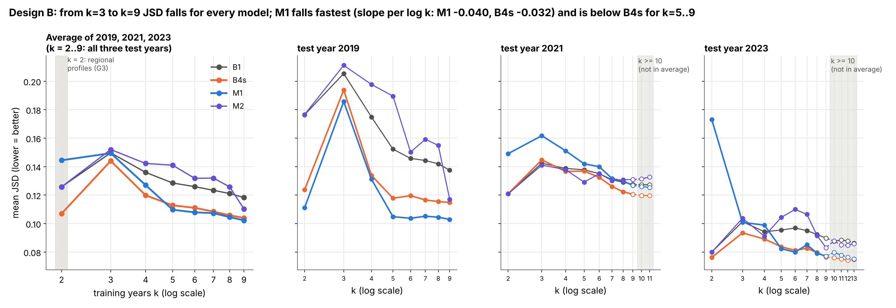
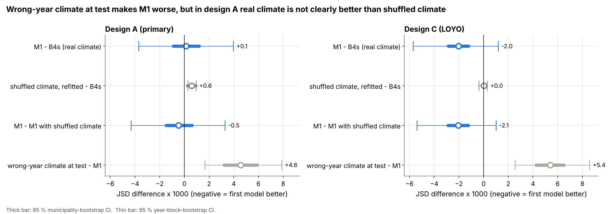
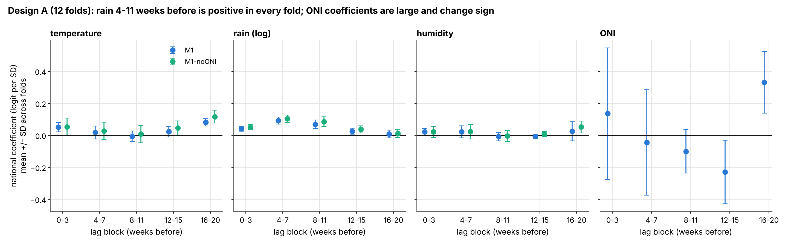
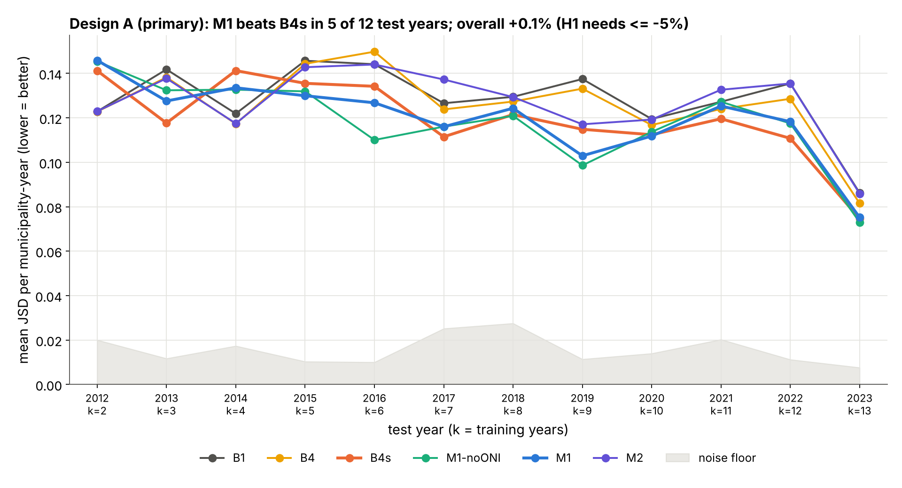
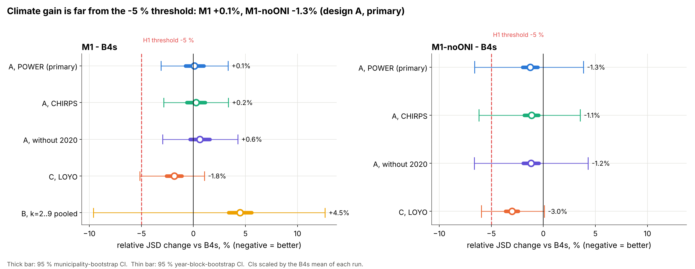
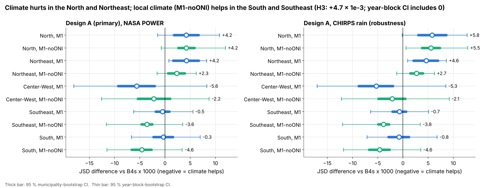
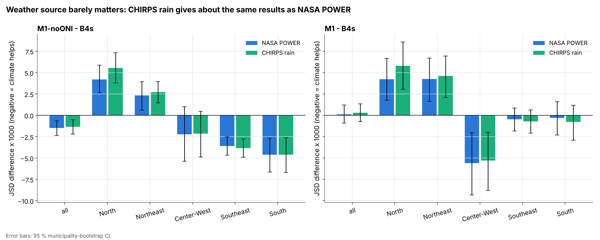

# Official results: 300 municipalities, 2010–2023 (2024 pending)

**Status.** These are the results of the official experiment, run as fixed in the pre-registered run plan (Amendment 1: NASA POWER is the primary climate source because ERA5-Land could not be obtained). The 2024 fold has **not** been run (`RUN_FINAL_2024 = False`): 2024 was never loaded. H1 also needs the 2024 sign check, so every decision below covers 2010–2023 only.

Every number in this file is copied from a CSV in [`tables/`](tables/), produced by

```bash
python scripts/run_pipeline.py --step official-report    # about 15 s; needs the local metrics_detail files
```

Labels: **design A (primary)** = expanding window, NASA POWER; **design B** = learning curve; **design C** = leave-one-year-out (pilot comparison). JSD is the primary metric (lower = better). Differences are "first model minus second model", so a negative difference means the first model is better. Intervals are 95 % percentile intervals from 2,000 bootstrap replicates (seed 1): "muni" resamples municipalities, "year" resamples test years.

---

## 1. Plain-language summary

- **H1 is NOT SUPPORTED.** In design A (primary), the climate model M1 (local weather + El Niño index) is no better than the same model without climate (B4s): JSD +0.1 % (municipality interval −0.0009 to +0.0012; year-block interval −0.0037 to +0.0040). M1 wins in only 5 of 12 test years. The pre-registered bar was a 5 % improvement with both intervals below zero.
- **The El Niño index (ONI) made things worse.** With local weather only (M1-noONI), the JSD is 1.3 % lower than B4s (municipality interval below zero, year-block interval not). Adding ONI raises the error by 1.4 %. The fitted ONI coefficients are large and change sign between folds. Local weather alone also stays far from the 5 % bar.
- **The climate signal is real but small.** Giving the trained M1 another year's weather makes it 3.8 % worse (both intervals above zero), so the model does use the year's weather. In design A, however, M1 is not clearly better than an M1 refitted on shuffled weather (−0.4 %, both intervals include zero).
- **The size of the year matters most.** Adding the annual-size terms (B4s vs B4) lowers JSD by 5.3 % (10 of 12 years better; the year-block interval just includes zero), by 17.0 % when weighted by case numbers, and by 12.9 % in epidemic years.
- **More training years help, and help the climate model most (H4).** Between 3 and 9 training years, the error falls for every model. M1 falls fastest and is 1–3 % below B4s from 5 training years on (averaged over the three test years; the year-block intervals include zero). With only 2–4 years M1 is clearly worse than B4s. With 2 years every model uses regional seasonal profiles, which happen to work well, so k = 2 is out of line. Beyond 9 years only 2021 and 2023 remain; in those two years M1 does not beat B4s.
- **H2 and H3 are NOT SUPPORTED.** Long lags do not help: M1 is 2.1 % worse than M1-short (lags 0–3 weeks only). The regional pattern points the expected way: climate hurts in the North and Northeast, and local weather helps in the South and Southeast. But the year-block interval of the H3 contrast includes zero.
- **Robust to the checks.** CHIRPS rainfall gives the same results as NASA POWER (M1 differs by +0.1 %). Dropping 2020 does not change any conclusion. Design C reproduces the pilot's 300-municipality numbers exactly.
- **Where climate helps, it helps in epidemic years.** In the top tercile of years (annual cases at least 2.24 × the municipality's training median), M1-noONI is 4.3 % better than B4s. In the other years the gain is about zero.

## 2. Hypothesis decisions

Design A (primary), NASA POWER, 300 municipalities, 12 test years (2012–2023), 3,194 municipality-years ([`tables/hypotheses.csv`](tables/hypotheses.csv)). The p-value is the larger of the two two-sided bootstrap p-values (both intervals must agree); Holm adjusts it across H1–H3.

| | Contrast | Estimate | Relative | 95 % CI, muni | 95 % CI, year | p | p (Holm) | Decision | Decision (Holm) |
|---|---|---|---|---|---|---|---|---|---|
| **H1** | JSD M1 − B4s (≤ −5 % and both CIs < 0; 2024 sign) | +0.00012 | +0.1 % | [−0.00090, +0.00120] | [−0.00370, +0.00396] | 0.913 | 0.913 | **NOT SUPPORTED** | **NOT SUPPORTED** |
| **H2** | JSD M1 − M1-short (< 0, both CIs < 0) | +0.00247 | +2.1 % | [+0.00185, +0.00309] | [−0.00172, +0.00675] | 0.242 | 0.726 | **NOT SUPPORTED** | **NOT SUPPORTED** |
| **H3** | gain (B4s − M1) in South+Southeast minus North (> 0, both CIs > 0) | +0.00467 | – | [+0.00209, +0.00746] | [−0.00420, +0.01318] | 0.308 | 0.726 | **NOT SUPPORTED** | **NOT SUPPORTED** |
| **H4** | descriptive (Section 4) | – | – | – | – | – | – | JSD falls with k from k = 3; the M1 − B4s gap shrinks | – |

H2 fails in the wrong direction: the municipality interval is *above* zero, so in design A the long lags hurt. H3 points the expected way, and its municipality interval excludes zero, but its year-block interval does not. Because H1 fails on 2010–2023 already, the 2024 fold cannot make it supported.

The same rules applied to the robustness runs (descriptive only; same CSV):

| Run | H1: M1 − B4s | H2: M1 − M1-short | H3 |
|---|---|---|---|
| Design A, CHIRPS rain | +0.2 %, muni [−0.00075, +0.00136], year [−0.00339, +0.00399]: not supported | +2.2 %: not supported | +0.00651, muni [+0.00364, +0.00962], year [−0.00297, +0.01570]: not supported |
| Design A without 2020 | +0.6 %, muni [−0.00038, +0.00190], year [−0.00355, +0.00512]: not supported | +2.4 %: not supported | +0.00425, muni [+0.00130, +0.00739], year [−0.00514, +0.01428]: not supported |
| Design C (LOYO) | −1.8 %, muni [−0.00287, −0.00122], year [−0.00571, +0.00118]: not supported | +0.1 %: not supported | +0.00749, muni [+0.00584, +0.00923], year [−0.00090, +0.01656]: not supported |

## 3. Design A (primary): all models and pre-specified contrasts

### 3.1 Mean scores ([`tables/model_means.csv`](tables/model_means.csv))

| Model | JSD [95 % CI, muni] | N-weighted JSD | Peak-week error (weeks) |
|---|---|---|---|
| B0 uniform | 0.1861 [0.1797, 0.1926] | 0.2110 | 11.74 |
| B1 seasonal profile | 0.1282 [0.1230, 0.1337] | 0.1064 | 6.27 |
| B4 DM, base-paper structure | 0.1256 [0.1204, 0.1310] | 0.1054 | 6.22 |
| **B4s** DM + annual size (comparator) | **0.1190** [0.1137, 0.1247] | 0.0875 | 6.41 |
| **M1** B4s + local climate + ONI | **0.1191** [0.1138, 0.1247] | 0.0862 | 6.26 |
| M1-noONI (local climate only) | 0.1175 [0.1121, 0.1232] | 0.0829 | 6.25 |
| M1-short (lags 0–3 weeks) | 0.1166 [0.1114, 0.1223] | 0.0850 | 6.30 |
| M2 boosted softmax | 0.1267 [0.1216, 0.1321] | 0.1009 | 6.21 |
| M1-shufTT (shuffled climate, refitted) | 0.1196 [0.1144, 0.1253] | 0.0876 | 6.40 |
| M1-shufTest (wrong-year climate at test) | 0.1237 [0.1184, 0.1294] | 0.0903 | 6.42 |

Mean noise floor (multinomial sampling): 0.0152.

### 3.2 Paired contrasts, JSD ([`tables/paired_contrasts.csv`](tables/paired_contrasts.csv))

Differences × 1000. Headroom = share of the gap between the second model and the noise floor that the first model closes.

| Contrast | Mean a | Mean b | Diff × 1000 | Relative | 95 % CI, muni | 95 % CI, year | Years a better | Headroom |
|---|---|---|---|---|---|---|---|---|
| H1: M1 − B4s | 0.1191 | 0.1190 | +0.12 | +0.1 % | [−0.90, +1.20] | [−3.70, +3.96] | 5/12 | −0.1 % |
| H2: M1 − M1-short | 0.1191 | 0.1166 | +2.47 | +2.1 % | [+1.85, +3.09] | [−1.72, +6.75] | 3/12 | −2.4 % |
| Local climate only: M1-noONI − B4s | 0.1175 | 0.1190 | −1.49 | −1.3 % | [−2.35, −0.62] | [−7.86, +4.59] | 6/12 | +1.4 % |
| ONI effect: M1 − M1-noONI | 0.1191 | 0.1175 | +1.62 | +1.4 % | [+0.98, +2.27] | [−1.05, +5.00] | 5/12 | −1.6 % |
| Size terms: B4s − B4 | 0.1190 | 0.1256 | −6.64 | −5.3 % | [−8.26, −5.05] | [−12.73, +1.19] | 10/12 | +6.0 % |
| M1 − B1 (seasonal profile) | 0.1191 | 0.1282 | −9.07 | −7.1 % | [−10.80, −7.29] | [−16.18, −0.64] | 10/12 | +8.0 % |
| M2 − B4s | 0.1267 | 0.1190 | +7.75 | +6.5 % | [+6.23, +9.32] | [−0.64, +14.85] | 2/12 | −7.5 % |
| Shuffle check: M1-shufTT − B4s | 0.1196 | 0.1190 | +0.59 | +0.5 % | [+0.25, +0.93] | [+0.28, +0.95] | 2/12 | −0.6 % |
| Real vs shuffled climate: M1 − M1-shufTT | 0.1191 | 0.1196 | −0.47 | −0.4 % | [−1.47, +0.61] | [−4.33, +3.29] | 5/12 | +0.5 % |
| Wrong-year climate: M1-shufTest − M1 | 0.1237 | 0.1191 | +4.56 | +3.8 % | [+3.21, +5.91] | [+1.66, +7.88] | 3/12 | −4.4 % |

**Secondary metrics** (same CSV, design A):

| Contrast | Peak-week error, diff (weeks) [muni] [year] | N-weighted JSD, diff × 1000 (relative) [muni] [year] |
|---|---|---|
| M1 − B4s | −0.15 (−2.4 %) [−0.27, −0.03] [−0.38, +0.08] | −1.25 (−1.4 %) [−4.38, +1.42] [−7.41, +4.62] |
| M1-noONI − B4s | −0.16 (−2.5 %) [−0.28, −0.04] [−0.41, +0.10] | −4.61 (−5.3 %) [−7.59, −2.21] [−12.75, +3.65] |
| M1 − M1-noONI | +0.01 (+0.2 %) [−0.09, +0.11] [−0.24, +0.26] | +3.36 (+4.1 %) [+2.10, +4.66] [+0.54, +6.43] |
| M1 − M1-short | −0.04 (−0.6 %) [−0.14, +0.07] [−0.24, +0.15] | +1.25 (+1.5 %) [−0.63, +2.89] [−4.01, +6.98] |
| B4s − B4 | +0.19 (+3.1 %) [+0.06, +0.32] [−0.11, +0.56] | −17.97 (−17.0 %) [−27.20, −6.94] [−29.95, −0.19] |

The N-weighted results (large epidemics count more) favour local climate more: M1-noONI − B4s is −5.3 %, but its year-block interval includes zero. ONI hurts on this scale too, and here both intervals exclude zero (+4.1 %).

### 3.3 By test year ([`tables/gain_by_test_year.csv`](tables/gain_by_test_year.csv), [`tables/jsd_by_test_year.csv`](tables/jsd_by_test_year.csv))

| Test year | k | n | M1 − B4s × 1000 [muni] | M1-noONI − B4s × 1000 [muni] |
|---|---|---|---|---|
| 2012 | 2 | 236 | +4.67 [−0.21, +9.75] | +4.20 [+0.82, +7.48] |
| 2013 | 3 | 275 | +9.94 [+5.58, +14.43] | +14.75 [+10.99, +18.84] |
| 2014 | 4 | 251 | −7.72 [−11.80, −3.92] | −8.58 [−11.64, −5.55] |
| 2015 | 5 | 279 | −5.58 [−8.65, −2.38] | −3.60 [−5.74, −1.47] |
| 2016 | 6 | 291 | −7.42 [−11.15, −3.57] | −24.15 [−26.82, −21.56] |
| 2017 | 7 | 259 | +4.52 [+1.98, +7.26] | +4.57 [+2.49, +6.60] |
| 2018 | 8 | 237 | +2.84 [−0.16, +5.85] | −0.59 [−2.73, +1.52] |
| 2019 | 9 | 268 | −11.92 [−14.27, −9.74] | −16.24 [−19.15, −13.44] |
| 2020 | 10 | 272 | −0.60 [−3.04, +1.77] | +1.28 [−0.92, +3.52] |
| 2021 | 11 | 245 | +5.73 [+3.55, +7.83] | +7.65 [+5.45, +9.91] |
| 2022 | 12 | 288 | +7.51 [+5.02, +9.93] | +6.72 [+4.30, +9.08] |
| 2023 | 13 | 293 | +0.55 [−2.23, +3.23] | −1.62 [−3.56, +0.24] |

Climate helps clearly in 2014, 2015, 2016 and 2019, and hurts clearly in 2013, 2017, 2021 and 2022. The sign changes from year to year, which is why the year-block intervals are wide. In design A the training size grows with the test year, so this table mixes year effects with training-size effects; design B separates them (Section 4).

### 3.4 By region ([`tables/gain_by_region.csv`](tables/gain_by_region.csv))

| Region | n | M1 − B4s × 1000 [muni] [year] | M1-noONI − B4s × 1000 [muni] [year] |
|---|---|---|---|
| North | 433 | +4.23 [+1.75, +6.66] [−1.45, +10.82] | +4.21 [+2.62, +5.87] [−0.77, +11.96] |
| Northeast | 510 | +4.25 [+1.63, +6.69] [+0.74, +8.25] | +2.32 [+0.62, +3.92] [−1.60, +6.17] |
| Center-West | 506 | −5.61 [−9.32, −2.03] [−18.12, +8.27] | −2.23 [−5.39, +1.01] [−12.61, +8.75] |
| Southeast | 1,375 | −0.47 [−1.83, +0.85] [−6.20, +5.52] | −3.59 [−4.65, −2.54] [−11.65, +3.51] |
| South | 370 | −0.30 [−2.30, +1.59] [−6.67, +6.95] | −4.60 [−6.64, −2.68] [−11.53, +3.40] |
| (South+Southeast) − North, gain | | +4.67 [+2.09, +7.46] [−4.20, +13.18] | +8.02 [+6.16, +9.92] [−0.45, +16.77] |

Climate makes the reconstruction worse in the North and Northeast, where satellite and reanalysis rainfall is least reliable. Local weather helps in the South and Southeast. With ONI added, that gain disappears there and moves to the Center-West.

### 3.5 Epidemic vs quiet years ([`tables/gain_epidemic_vs_quiet.csv`](tables/gain_epidemic_vs_quiet.csv))

A municipality-year is *epidemic* if its annual total divided by the median annual total of the municipality's training years is in the top tercile of the run (cut 2.24); otherwise it is *quiet*. The annual totals are read from the processed dengue table with a year filter, so 2024 is never read.

| Stratum | n | M1 − B4s × 1000 (rel.) [muni] [year] | M1-noONI − B4s × 1000 (rel.) [muni] [year] | B4s − B4 × 1000 (rel.) [muni] [year] |
|---|---|---|---|---|
| Epidemic | 1,065 | −2.11 (−1.8 %) [−4.09, −0.06] [−8.41, +3.94] | −5.15 (−4.3 %) [−6.72, −3.49] [−13.46, +2.82] | −17.74 (−12.9 %) [−21.27, −14.34] [−26.88, −5.35] |
| Quiet | 2,129 | +1.24 (+1.0 %) [+0.08, +2.34] [−1.70, +4.17] | +0.34 (+0.3 %) [−0.59, +1.25] [−5.37, +5.49] | −1.08 (−0.9 %) [−2.70, +0.45] [−6.74, +5.43] |

## 4. H4: learning curve (design B)

Test years 2019, 2021 and 2023. For each, the models train on the k years just before it. 2019 has at most k = 9 (2010–2018). **The main summary therefore uses k = 2..9, where all three test years are present.** For k ≥ 10 the average covers fewer test years (2021 and 2023 for k = 10–11, 2023 only for k = 12–13), so it is shown separately and not used for trends. At k = 2 every municipality uses its region's seasonal profile, because the pilot rule needs at least 3 training years for a municipality's own profile (DEVIATIONS G3). Sources: [`tables/lc_jsd_averaged.csv`](tables/lc_jsd_averaged.csv), [`tables/lc_jsd_by_test_year_k.csv`](tables/lc_jsd_by_test_year_k.csv), [`tables/lc_slopes.csv`](tables/lc_slopes.csv), [`tables/lc_gap_M1_B4s_by_k.csv`](tables/lc_gap_M1_B4s_by_k.csv).

### 4.1 Mean JSD by k (equal-weight average of the three test years)

| k | B1 | B4s | M1 | M2 | M1 − B4s × 1000 (rel.) [muni] [year] |
|---|---|---|---|---|---|
| 2 (regional profiles) | 0.1258 | 0.1070 | 0.1445 | 0.1258 | +39.60 (+37.5 %) [+34.81, +44.18] [−12.60, +96.91] |
| 3 | 0.1497 | 0.1440 | 0.1494 | 0.1520 | +5.16 (+3.6 %) [+3.06, +7.23] [−8.10, +17.00] |
| 4 | 0.1359 | 0.1199 | 0.1270 | 0.1422 | +7.03 (+5.9 %) [+4.95, +9.05] [−2.74, +14.50] |
| 5 | 0.1285 | 0.1128 | 0.1097 | 0.1410 | −3.26 (−2.9 %) [−4.93, −1.56] [−12.98, +5.09] |
| 6 | 0.1259 | 0.1110 | 0.1079 | 0.1318 | −3.44 (−3.1 %) [−4.89, −1.91] [−15.85, +7.51] |
| 7 | 0.1234 | 0.1084 | 0.1073 | 0.1319 | −1.19 (−1.1 %) [−3.08, +0.68] [−11.43, +5.55] |
| 8 | 0.1211 | 0.1058 | 0.1045 | 0.1258 | −1.55 (−1.5 %) [−3.06, +0.02] [−10.99, +7.57] |
| 9 | 0.1183 | 0.1040 | 0.1023 | 0.1103 | −1.88 (−1.8 %) [−3.25, −0.44] [−11.92, +6.19] |
| *k ≥ 10, fewer test years (not comparable):* | | | | | |
| *10 (2021, 2023)* | *0.1074* | *0.0978* | *0.1029* | *0.1096* | *+4.91 (+5.1 %) [+2.99, +6.80]* |
| *11 (2021, 2023)* | *0.1078* | *0.0974* | *0.1016* | *0.1088* | *+4.05 (+4.2 %) [+2.23, +5.79]* |
| *12 (2023 only)* | *0.0878* | *0.0743* | *0.0764* | *0.0847* | *+2.10 (+2.8 %) [−0.94, +5.04]* |
| *13 (2023 only)* | *0.0862* | *0.0746* | *0.0751* | *0.0859* | *+0.55 (+0.7 %) [−2.23, +3.23]* |

The M1 − B4s column pools the municipality-years of the test years present, so its relative change can differ slightly from the ratio of the averaged columns. With 2 or 3 test-year clusters the year-block intervals are very rough. For k = 12–13 there is a single test year, so no year-block interval is given.

### 4.2 Slope of JSD on log(k), with a municipality-bootstrap 95 % CI

| Series | k = 2..9, all test years (main) | k = 3..9 (sensitivity: without the regional-profile k = 2) |
|---|---|---|
| B1 | −0.0116 [−0.0139, −0.0092] | −0.0267 [−0.0297, −0.0235] |
| B4s | −0.0120 [−0.0142, −0.0097] | −0.0323 [−0.0357, −0.0288] |
| M1 | −0.0340 [−0.0370, −0.0308] | −0.0401 [−0.0437, −0.0363] |
| M2 | −0.0121 [−0.0145, −0.0097] | −0.0320 [−0.0354, −0.0287] |
| **Gap M1 − B4s** | **−0.0220 [−0.0244, −0.0195]** | **−0.0078 [−0.0093, −0.0064]** |

Per test year, over all of that year's k (composition fixed within a year), the slope of the M1 − B4s gap is −0.0018 [−0.0040, +0.0005] for 2019 (k = 2..9), −0.0119 [−0.0152, −0.0087] for 2021 (k = 2..11) and −0.0319 [−0.0363, −0.0276] for 2023 (k = 2..13).

**Reading.**

- Every model improves with more training years once each municipality has its own profile (k ≥ 3).
- M1 improves fastest. Its 20 climate coefficients and regional deviations need many years to estimate. With 2–4 years M1 is worse than B4s; from k = 5 on it is 1–3 % better on average. That advantage is never clear on the year-block bootstrap.
- The gap shrinks with k in every test year, but at different levels. In 2019 M1 is better at every k. In 2023 it is much worse at small k and only equal at k = 12–13.
- So the step from k = 9 to k ≥ 10 in the average is a change in which test years are included, not a trend.
- The k = 2 point is out of line: there the regional profiles beat the 3-year municipal profiles for B1, B4s and M2.
- The slope is a pre-registered descriptive measure. The k = 3..9 version was added at reporting time as a sensitivity analysis and was not pre-specified.



## 5. Robustness

### 5.1 Weather source: CHIRPS rain vs NASA POWER ([`tables/cross_run_same_model.csv`](tables/cross_run_same_model.csv))

Same model, same municipality-years, CHIRPS run minus POWER run (design A):

| Model | JSD CHIRPS | JSD POWER | Diff × 1000 (rel.) [muni] [year] |
|---|---|---|---|
| B4s (no climate) | 0.1190 | 0.1190 | 0 (identical, as expected) |
| M1-noONI | 0.1176 | 0.1175 | +0.15 (+0.1 %) [−0.16, +0.45] [−0.67, +0.94] |
| M1 | 0.1193 | 0.1191 | +0.17 (+0.1 %) [−0.11, +0.43] [−0.39, +0.72] |
| M2 | 0.1267 | 0.1267 | −0.05 (−0.0 %) [−0.46, +0.35] [−1.09, +1.02] |

CHIRPS does not rescue the North: there M1-noONI − B4s is +5.54 × 10⁻³ with CHIRPS against +4.21 × 10⁻³ with POWER ([`tables/gain_by_region.csv`](tables/gain_by_region.csv)).

### 5.2 Without 2020

Design A rerun with 2020 excluded everywhere (training, climatology, scoring; 11 folds; [`tables/paired_contrasts.csv`](tables/paired_contrasts.csv)): M1 − B4s = +0.6 % (×1000: +0.75 [−0.38, +1.90] [−3.55, +5.12], 4/11 years better). M1-noONI − B4s = −1.2 % (−1.41 [−2.32, −0.50] [−7.98, +5.18]). ONI effect +1.8 %, size effect −5.1 %. No conclusion changes.

### 5.3 Design C (LOYO) and the pilot ([`tables/designC_vs_pilot.csv`](tables/designC_vs_pilot.csv))

The official design C reproduces the pilot's 300-municipality LOYO run exactly (3,723 rows; |difference| < 1e-16) for B0, B1, B4, B4s and M1-noONI, which is the pilot M1. Example: M1-noONI 0.10767, and M1-noONI − B4s −0.00335 [−0.00404, −0.00267] [−0.00660, +0.00011], the pilot's numbers. The new 20-feature M1 is worse than the pilot M1 in design C as well: M1 − M1-noONI is +1.2 %, and M1 − B4s is −1.8 % instead of −3.0 %. Design C uses future years for training, so it is optimistic compared with design A: M1-noONI − B4s is −3.0 % in C against −1.3 % in A.

### 5.4 Shuffle checks

- **Wrong-year weather at test** makes M1 worse in every run: design A +3.8 %; design C +5.0 %. Both intervals are above zero in both designs.
- **M1 refitted on shuffled weather** (M1-shufTT) is 0.5 % worse than B4s in design A, with both intervals above zero. So the penalised fit pays a small price for pure noise.
- **Real against shuffled weather.** In design C, M1 beats M1-shufTT by 1.8 % (municipality interval below zero). In design A it does so by only 0.4 %, with both intervals including zero.



## 6. Fitted climate coefficients ([`tables/climate_coefficients.csv`](tables/climate_coefficients.csv))

National coefficients of M1 in design A, logit scale per standard deviation of the lag-block anomaly; mean ± SD across the 12 folds; folds > 0 out of 12. Region-specific values (national + regional deviation) are in the CSV.

| Lag block (weeks before) | Temperature | Rain (log) | Humidity | ONI |
|---|---|---|---|---|
| 0–3 | 0.050 ± 0.029 (11) | 0.041 ± 0.015 (11) | 0.022 ± 0.021 (11) | 0.136 ± 0.411 (8) |
| 4–7 | 0.018 ± 0.041 (11) | **0.092 ± 0.022 (12)** | 0.021 ± 0.038 (11) | −0.044 ± 0.330 (4) |
| 8–11 | −0.007 ± 0.033 (5) | **0.069 ± 0.027 (12)** | −0.008 ± 0.027 (5) | −0.101 ± 0.136 (2) |
| 12–15 | 0.023 ± 0.033 (11) | 0.026 ± 0.019 (11) | −0.008 ± 0.013 (4) | −0.229 ± 0.198 (2) |
| 16–20 | **0.082 ± 0.023 (12)** | 0.009 ± 0.024 (6) | 0.025 ± 0.060 (7) | 0.331 ± 0.193 (11) |

- Rain 4–11 weeks before and temperature 16–20 weeks before are positive in every fold, as in the pilot.
- The ONI coefficients are 3–10 times larger and flip sign across folds (block 0–3 ranges from −0.560 to +0.586). ONI is one national series with only a few ENSO episodes per training window, so its coefficients mostly fit year-to-year noise in the seasonal timing. This matches its negative effect on accuracy.



## 7. Figures

All in [`figures/`](figures/); every number in them is in the CSVs above.

| File | Shows |
|---|---|
| [`figA_designA_jsd_by_test_year.png`](figures/figA_designA_jsd_by_test_year.png) | Design A: mean JSD by test year for B1, B4, B4s, M1-noONI, M1, M2, with the noise floor |
| [`figB_learning_curves.png`](figures/figB_learning_curves.png) | Design B: averaged curve for k = 2..9, plus one panel per test year with k ≥ 10 shaded and dashed |
| [`figC_gain_with_CIs.png`](figures/figC_gain_with_CIs.png) | M1 − B4s and M1-noONI − B4s (relative) with both CIs, for every run, and the −5 % threshold |
| [`figD_gain_by_region.png`](figures/figD_gain_by_region.png) | Gain by region, POWER and CHIRPS, with both CIs |
| [`figE_shuffle_test.png`](figures/figE_shuffle_test.png) | Shuffle checks, designs A and C |
| [`figF_weather_source.png`](figures/figF_weather_source.png) | POWER vs CHIRPS: gain overall and by region |
| [`figG_climate_coefficients.png`](figures/figG_climate_coefficients.png) | Fitted climate and ONI coefficients across the 12 design-A folds |






## 8. Limitations

- **NASA POWER is the primary climate source because ERA5-Land could not be obtained** (Open-Meteo quota; Copernicus needs an account). This is Amendment 1, made before any official run. CHIRPS rain gives the same results, but neither run shows which source is closer to the truth.
- **North rainfall is uncertain.** Climate hurts most in the North and Northeast, where gridded and point rain products disagree most ([`docs/WEATHER_VALIDATION.md`](../../docs/WEATHER_VALIDATION.md)). Part of the H3 contrast may therefore reflect data quality, not biology.
- **M2 early stopping often kept 1 round.** In 3 of 12 design-A folds (2 of 12 with CHIRPS, 3 of 11 without 2020, 3 of 30 in design B, 2 of 14 in design C), the inner validation year chose a single boosting round ([`tables/fold_log_summary.csv`](tables/fold_log_summary.csv)). M2 is then close to its starting point. This follows the fixed rule and was not tuned.
- **k = 2 uses regional profiles** (DEVIATIONS G3). This affects the first design-A fold (2012) and the k = 2 points of design B.
- **2024 is pending.** H1 also needs the sign of the 2024 fold. It cannot change the "not supported" decision, but the 2024 numbers will be appended after the go-ahead.
- **Few year clusters.** Design A has 12 test years (design B 3, so its year-block intervals are only indicative). The year-block intervals are wide because the climate gain changes sign between years.
- **Epidemic definition.** The tercile cut is taken over the scored municipality-years of each run, with the training median of each fold. Annual totals come from the processed InfoDengue table. The step is skipped when that table is absent.
- **Reconstructions are not data for climate–dengue models.** Using them to estimate climate effects would be circular.

## 9. File index

| Path | Content |
|---|---|
| `tables/model_means.csv` | Mean JSD (municipality CI), N-weighted JSD, peak error per model and run (design B: k = 2..9) |
| `tables/paired_contrasts.csv` | All 10 pre-specified contrasts × {JSD, peak error, N-weighted JSD} × run, with both CIs, p-values, folds better, headroom |
| `tables/hypotheses.csv` | H1–H3 decisions, unadjusted and Holm, for the primary run (`primary = True`) and robustness runs |
| `tables/jsd_by_test_year.csv`, `tables/gain_by_test_year.csv` | Per test year: model means, and M1/M1-noONI − B4s with municipality CIs |
| `tables/gain_by_region.csv` | Region contrasts and the (South+Southeast) − North gain contrast, both CIs |
| `tables/gain_epidemic_vs_quiet.csv` | Epidemic vs quiet strata |
| `tables/cross_run_same_model.csv` | CHIRPS − POWER and without-2020 − all, same model |
| `tables/designC_vs_pilot.csv` | Design C against the pilot 300-municipality LOYO run |
| `tables/lc_*.csv` | Design B: JSD by test year × k, averaged curve, slopes, M1 − B4s gap by k |
| `tables/climate_coefficients.csv` | Fitted θ (national) and θ + δ (regional) across folds, designs A and C |
| `tables/fold_log_summary.csv` | Convergence and M2 rounds per run and model |
| `figures/fig*.png` | Figures A–G |
| `<run>/model_summary_*.csv`, `fold_summary_*.csv`, `checks_*.json`, `leakage_audit_*.csv` | Per-run summaries and checks (step 4) |
| `<run>/metrics_detail_*.csv`, `<run>/folds/` | Per municipality-year metrics and fold checkpoints: **local only, not committed** (regenerate with `--step official`) |

Code: `src/dengue_recon/reporting/official_report.py`; tests: `tests/test_official_report.py`.
